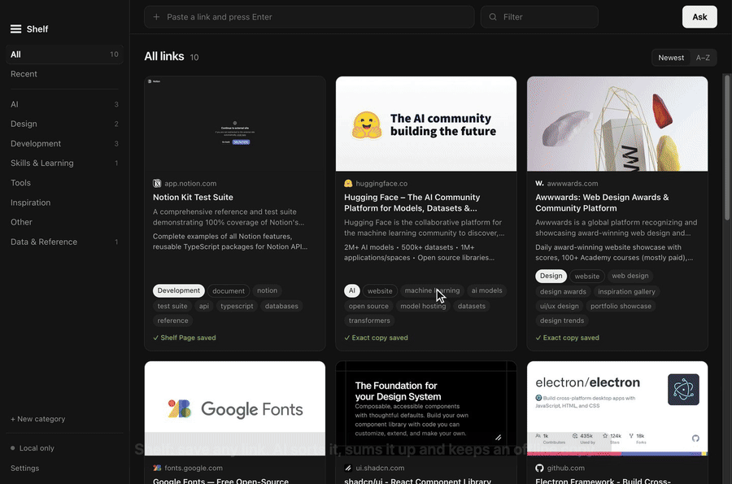
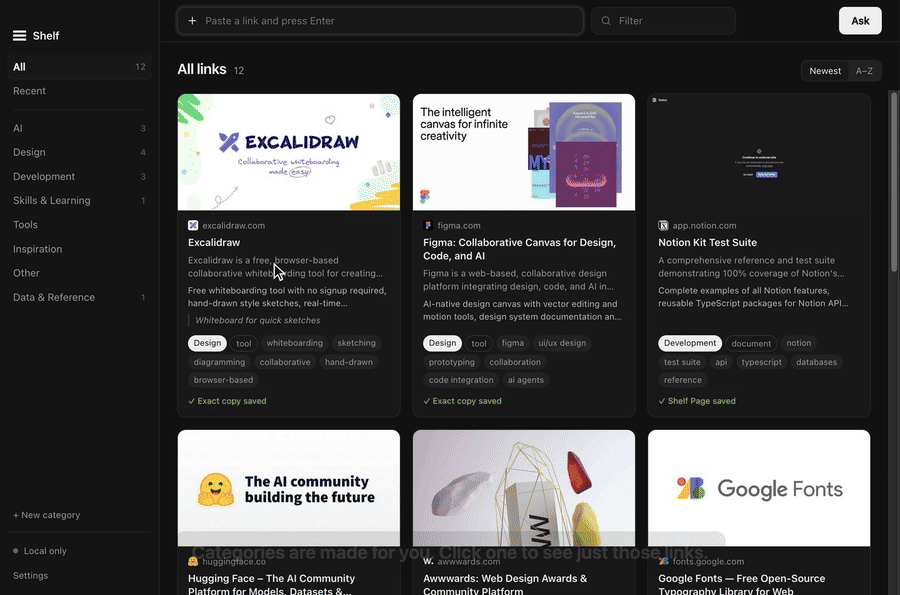
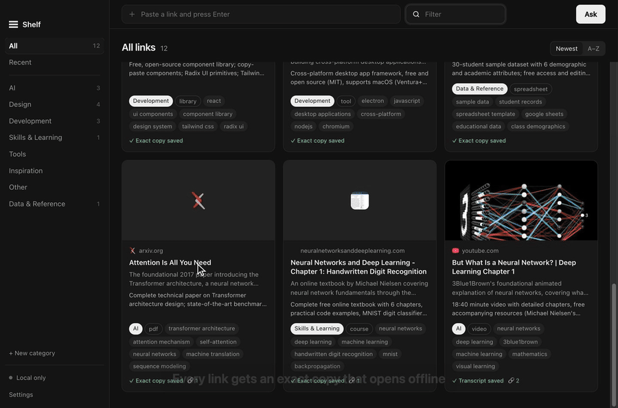
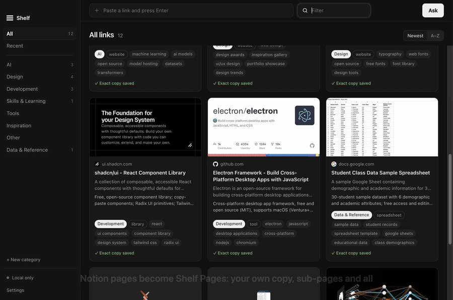
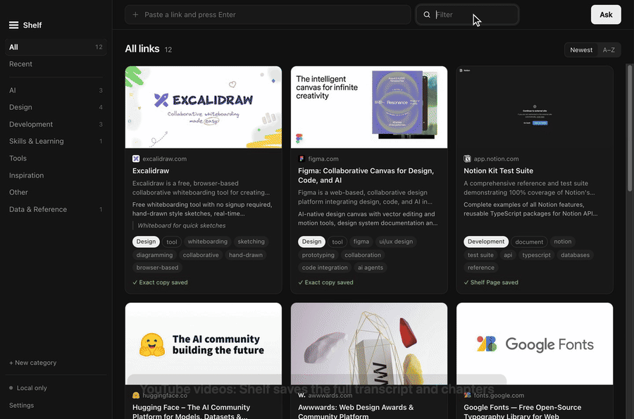
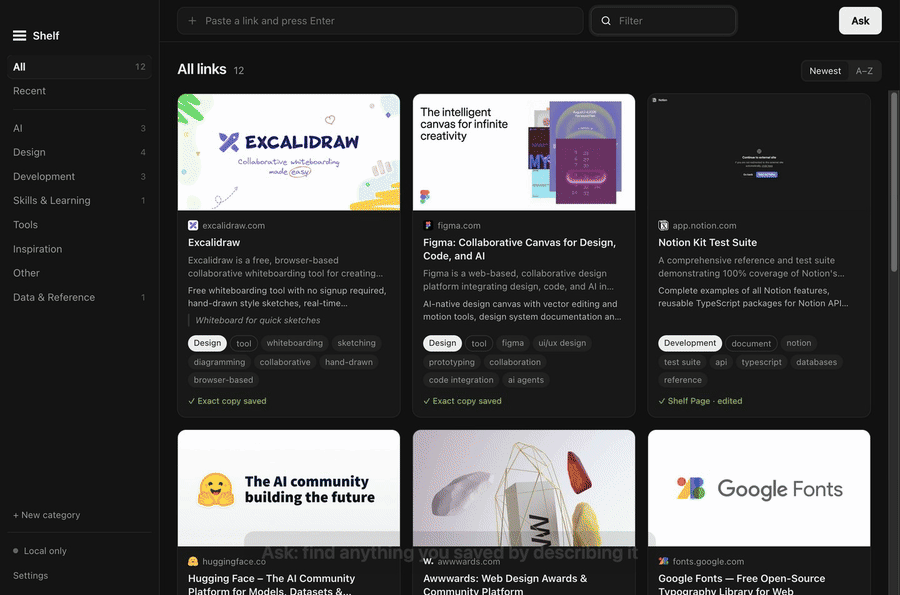
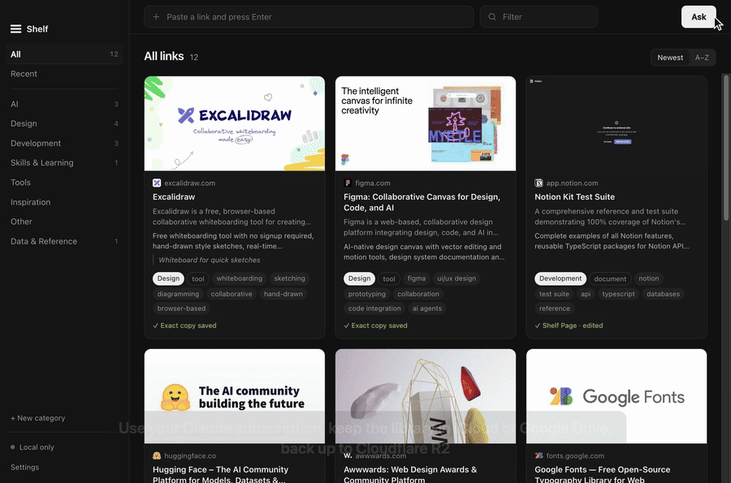
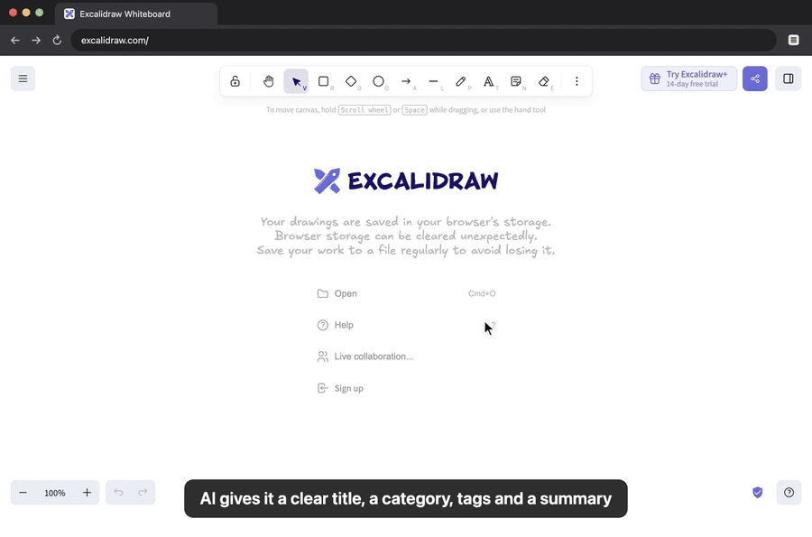

# Shelf

Save links you come across. Shelf reads each page, works out what it is and what it offers, files it under a category (AI, Design, Development, Skills & Learning, Tools, Inspiration, or your own), and finds things again when you ask.

Mac and Windows · Electron · MIT licensed · your data stays in your own folders and accounts.



**▶ [Watch the full demo (2 min 45 s)](docs/demo/shelf-demo.mp4)**: saving links, the Chrome extension, YouTube transcripts, offline copies, Shelf Pages, Ask and Settings. Each feature below also has its own short clip.

## Install

Download the latest version from [Releases](https://github.com/walidriachy/shelf/releases/latest), or build it yourself (below).

- **Mac:** open `Shelf-1.3.0-Mac-AppleSilicon.dmg` (M1/M2/M3/M4) or `Shelf-1.3.0-Mac-Intel.dmg` and drag Shelf into Applications. The app isn't signed yet, so the first time macOS says it can't be opened: go to **System Settings → Privacy & Security**, scroll down and click **Open Anyway**.
- **Windows:** run `Shelf-Setup-1.3.0-Windows.exe`. If SmartScreen warns you, click **More info → Run anyway**.

## Saving links

- Paste a link in the top bar and press Enter. You can paste several at once.
- Paste a link anywhere in the window.
- From any app, copy a link and press **⌘⇧L** (Windows: **Ctrl+Shift+L**).
- From Chrome, use the extension (below).

Categories are made for you. Click one in the sidebar to see just those links, or filter by any word:



## Shelf keeps an exact copy of everything



Every link you save is copied to your computer so it looks exactly like the original, so you don't lose it if the original is deleted, made private or moved:

- **Web pages and Notion pages:** a complete snapshot of the page (layout, styling, images and text, in one .mhtml file), plus a screenshot.
- **PDFs:** the original PDF file.
- **Google Docs:** the original as a PDF, plus a Word (.docx) copy.
- **Google Sheets:** a snapshot of the sheet as it looks, plus the full spreadsheet (.xlsx).
- **Google Slides:** the slides as a PDF.
- **Other files:** the original file.

Click a link, then **Open saved copy**. It opens inside Shelf with the internet blocked, so you always see the saved copy, never the live page. You can also open the files from the **Files** tab or with **Show files**.

The exact copies stay on the computer that saved them. Cloud sync carries each link's details, notes and text, but not the large copy files.

Claude also writes **Shelf notes** for each link: a structured write-up of what's inside, specific tags, key points, what it offers, what to use it for, and pricing. Search and Ask look through all of it, including the full saved copy.

If a link stops working, Shelf says so and keeps showing its saved copy.

**Private pages and Google files** (Docs, Sheets, Slides, Drive files and folders, anything behind a sign-in): save them with the Chrome extension. Google doesn't allow signing in inside other apps, so the extension downloads the file using the Google account you're signed in with in Chrome and hands it to Shelf: you get the full copy, Shelf Page and summary. Your password never touches Shelf. A file Shelf saved earlier as private gets updated when you save it again from Chrome. Private Notion pages: sign in once under **Settings → Private pages**.

Claude chooses the category. It uses your existing ones when they fit and creates a new one when nothing does.

Click a card to see its details, Shelf notes, full saved copy and files. ⌘-click (Ctrl-click on Windows) opens the site directly. Right-click a card, or click **Edit**, to change its category, tags or note, or to re-sort it.

## Shelf Pages



For Notion pages, Google Docs, Word files, PDFs (direct links or on Google Drive) and Google Slides, Shelf also builds a **Shelf Page**: its own editable copy made from the real content, not a picture of it.

- **Notion:** text formatting and colours, headings, lists, to-dos, toggles, callouts, quotes, code, columns, tables, images (downloaded), covers and icons, bookmarks, and up to 40 sub-pages. Databases come across as table, board, gallery or list views with their rows.
- **Google Docs and Word files:** headings, bold/italic/underline, text and highlight colours (Google Docs), lists (nested), tables, links, code blocks and pictures (downloaded).
- **PDFs and Slides:** rebuilt from the text (headings, paragraphs, lists), with every original page kept as a picture in an *Original pages* toggle at the bottom, so charts and layout aren't lost. Scanned PDFs show the pages themselves.

Shelf Pages open offline and follow light/dark mode. The original file or exact snapshot is still saved next to it. Links saved before this version get their page built from the files already saved, with nothing downloaded again.

Open it from the link's details (**Open Shelf Page**). Press **Edit** to change it: type anywhere, use the toolbar for headings, lists, to-dos, toggles, callouts, quotes, code, dividers, links and images, then **Save** (⌘S). Your edits are saved as *your version* next to the original, so **Reset to original** always brings the page back as Shelf first saved it. Not yet: calendar/timeline views (shown as tables). Formulas show their saved values.

### Share a Shelf Page

In the link's details (or the top bar of the Shelf Page window):

- **Export file** saves the whole page, sub-pages and images included, as **one .html file** that opens in any browser, offline. Send it by email, WhatsApp, AirDrop, anything. Your edits are included.
- **Share link** uploads that file to your Cloudflare R2 and copies a link anyone can open in a browser, no account needed. The bucket stays private: the link is signed and works for **7 days**. Press **Update link** after editing to refresh it (same address, newest version), or **Stop sharing** to delete it.

## YouTube videos



Save a YouTube link (watch, youtu.be, Shorts or live) and Shelf reads the video: title, channel, length, description, chapters and the **full transcript** with timestamps. To get the transcript, Shelf plays the video muted in a hidden window with captions on, the same text you see with CC. The AI uses all of it, so the notes walk through the video section by section with clickable timestamps, and **Ask** can answer questions from what was said. Videos without captions keep their title, description and chapters.

## Connected links

Keep things that belong together, together: a tutorial video and the PDF, Notion page or Google Drive file that explains it. Open a link's details and, under **Connected**, paste a link (Shelf saves and reads it too) or search what you've already saved. Connections go both ways, show a 🔗 on the card, and Ask knows about them.

## Ask

Click **Ask** (or press ⌘K / Ctrl+K) and type what you want, like "website design inspiration" or "free AI video tools". Shelf only answers from links you've saved.



## AI

Settings → AI → **Use** picks what does the thinking:

- **Automatic** (default): uses Claude if Claude Code is installed on the computer, otherwise Replicate if you've added a token, otherwise keywords.
- **Claude, with my subscription**: Shelf runs the Claude Code app on your computer, so it uses your own Claude plan with no API key or extra bill. Claude Code must be installed and signed in (run `claude` once in Terminal). Haiku is the default model because it's fast and light on your usage limits.
  - To use another account, run `claude setup-token` in Terminal and paste the token into Settings. Anyone else using Shelf pastes their own token.
- **Replicate**: paste a token from replicate.com/account/api-tokens. Pay per use.
- **Off**: keyword sorting and search only.

## Backup & sync

Settings → Backup & sync. Turn on whichever you want; they work on their own or together.



**Library folder.** Everything Shelf saves (one small file per link, plus the exact copies) lives in one folder:

- *This computer only*: `~/Library/Application Support/Shelf/library` (Windows: `%APPDATA%\Shelf\library`).
- *iCloud Drive* or *Google Drive*: Shelf finds them if the app is installed and signed in, and uses a `Shelf` folder there. The cloud app backs it up and keeps it the same on every computer. Pick the same place on your other computer and it joins the same library.
- *Choose a folder…*: Dropbox, OneDrive, a USB drive, anything.

Moving copies everything over first and only then removes the old copy on this computer. If the folder already has links (from another computer), yours are added and nothing is removed.

**Cloudflare R2 (10 GB free).** A full backup in your own Cloudflare account; every account gets 10 GB of R2 storage free, about 5,000 links.
1. Press **Open Cloudflare**. Sign in (or make a free account). The token page opens with the name filled in; check the permission is *Workers R2 Storage · Edit*, then Continue to summary → Create Token, and copy it. First time using R2? Open R2 in the Cloudflare menu once and turn it on (it asks for a card; nothing is charged under 10 GB).
2. Paste the token and press **Connect**. Shelf finds your account, creates a `shelf-backup` bucket and runs the first backup.

After that it backs up a few seconds after every change and every 5 minutes while Shelf is open, uploading only what changed. On a new computer, connect with a token from the same Cloudflare account and everything is restored. Disconnecting stops backups but leaves the bucket as it is. Prefer your own keys? Use "Use my own R2 keys instead".

**GitHub Gist.** A light extra that keeps links and their text in one private gist (token with only the `gist` scope).

Tokens and keys stay in `settings.json` on each computer and are never put in the cloud folder.

## Chrome extension



1. Open `chrome://extensions` and turn on **Developer mode**.
2. Click **Load unpacked** and pick the `extension` folder.
3. Click the Shelf icon → paste the connection key from Shelf → Settings → Chrome extension.

Then: click the icon (or press **Alt+S**) to save the current page with an optional note and category, or right-click any page or link → **Save to Shelf**. If the desktop app is closed, links wait in the extension and are sent once it's open.

For Google Docs, Sheets, Slides and Drive files, the extension also sends the files themselves, downloaded with your Chrome sign-in, so private ones are saved in full. That's why it asks to read docs.google.com and drive.google.com.

When you save the page you're on, the extension also sends it exactly as you see it: a full snapshot, its text and a screenshot. Shelf uses that whenever it can't open the page itself (private pages, anything behind a sign-in, like your Drive folders or a members-only article), so you never end up with only an address. Saving such a page again from Chrome updates its copy. Updating from an older version: open `chrome://extensions` and click the reload button on Shelf, then approve the new permission.

## Develop

```bash
npm install
npm start
npm run dist:mac   # or dist:win
```

The demo clips in `docs/demo` were recorded from the real app on a throwaway library of public links.

Settings and keys live in `settings.json` in the app's user-data folder (`~/Library/Application Support/Shelf` on Mac, `%APPDATA%\Shelf` on Windows); the library lives wherever you chose. See [CONTRIBUTING.md](CONTRIBUTING.md) for how the code is laid out and how to test.

## Roadmap, contributing, license

- What's done and what's next: [ROADMAP.md](ROADMAP.md)
- Want to help? [CONTRIBUTING.md](CONTRIBUTING.md)
- Found a security problem? [SECURITY.md](SECURITY.md)
- License: [MIT](LICENSE)
